# entrega-mockup-figma
Mockup/Prototipo de una tienda virtual como proyecto final del curso Programación II

Aquí puedes ver el diseño interactivo directamente en Figma:
[Ver mockup en Figma](https://www.figma.com/design/Opr8fLYiIwKSvnr5IY20SZ/Virtual-Store?node-id=42-2&t=jej3sSdOOTyAZy3d-1)

---

## Capturas de pantalla / Previsualización

### Login

### Registro
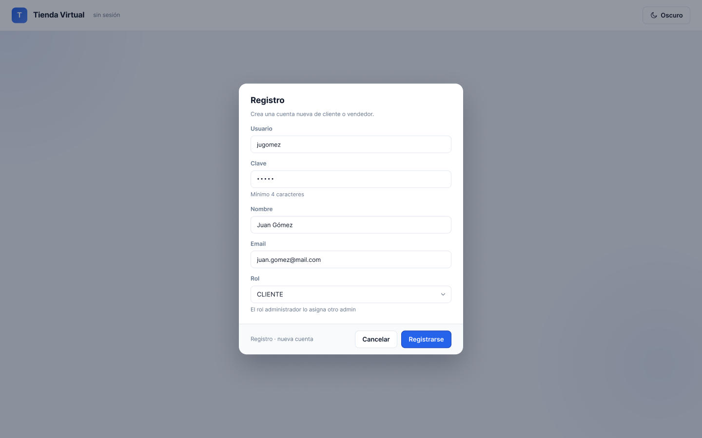

### Catalogo (Cliente)
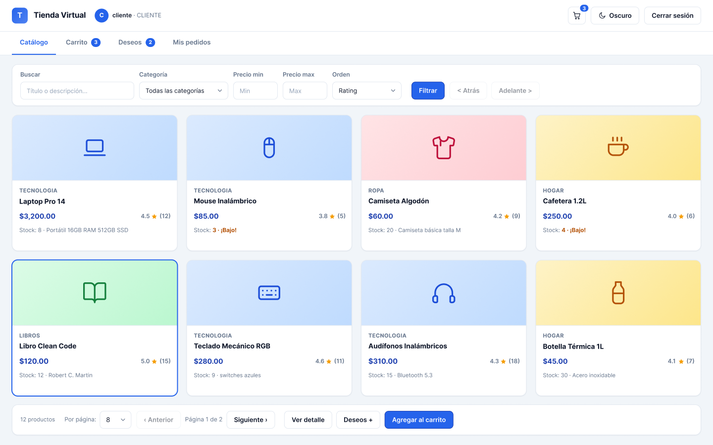

### Carrito
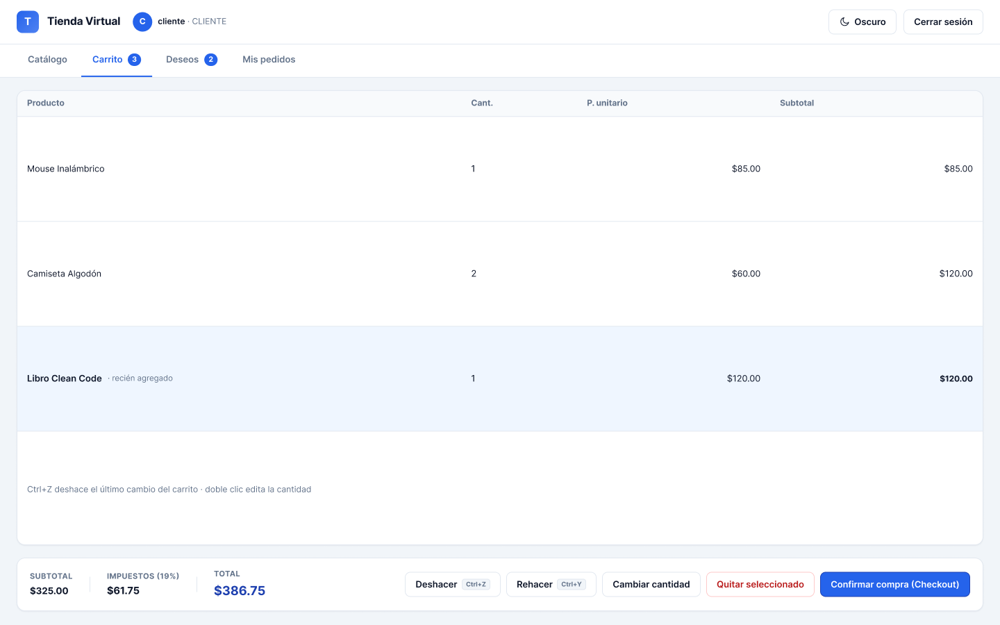

### Lista de Deseos
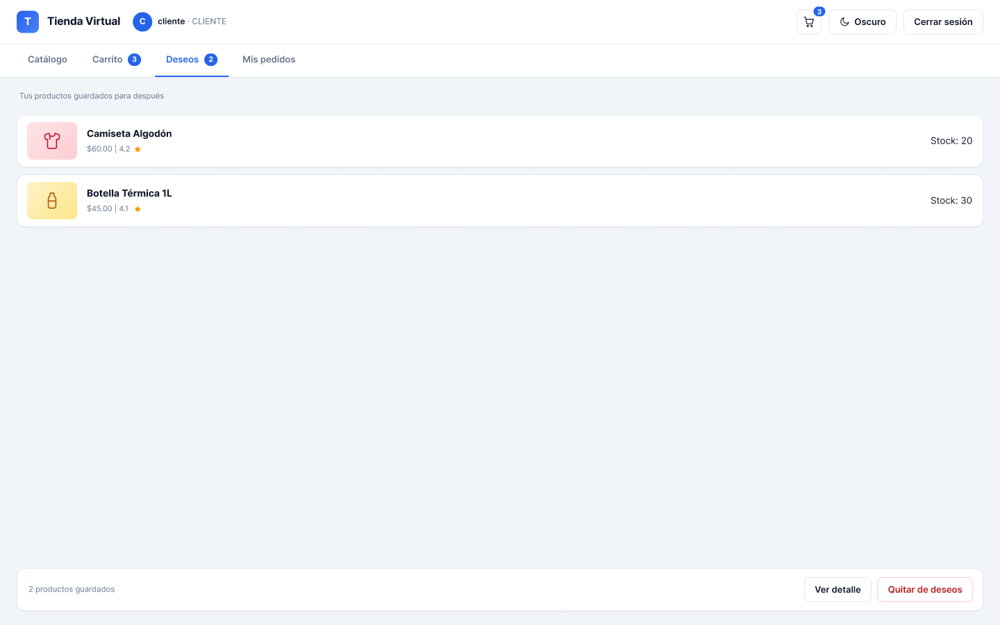

### Mis Pedidos
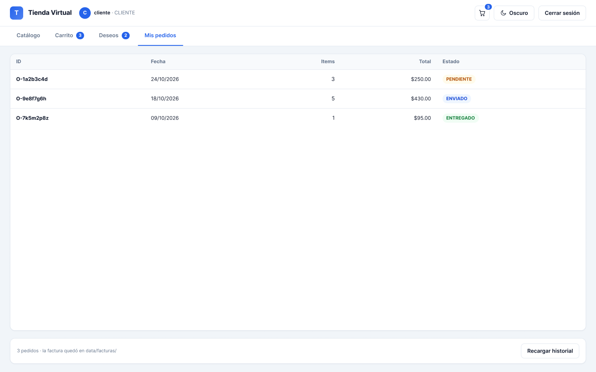

### Detalle Producto
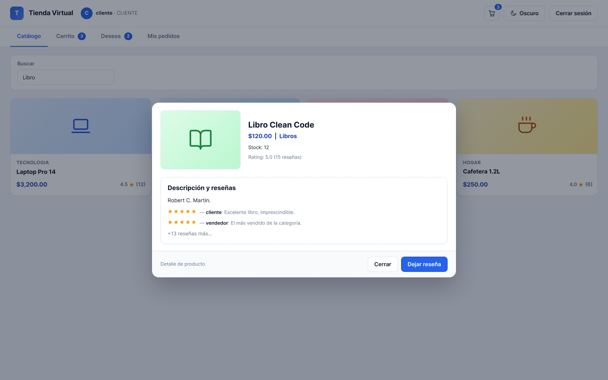

### Cola-LIFO (Vendedor)
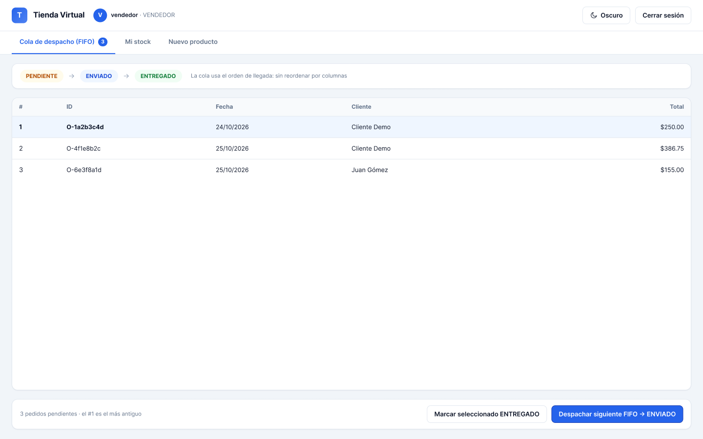

### Mi Stock
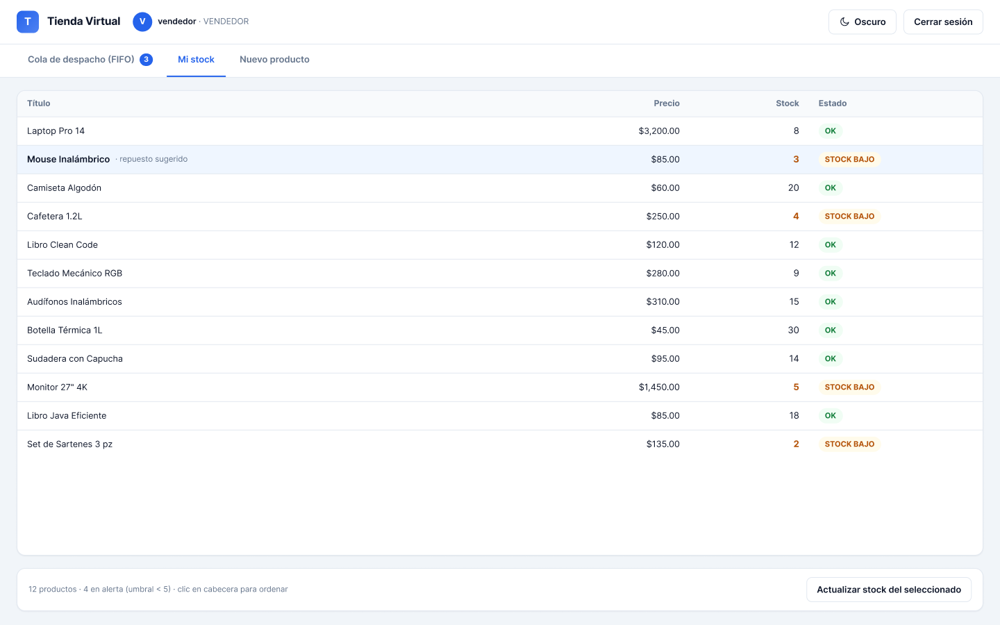

### Nuevo Producto
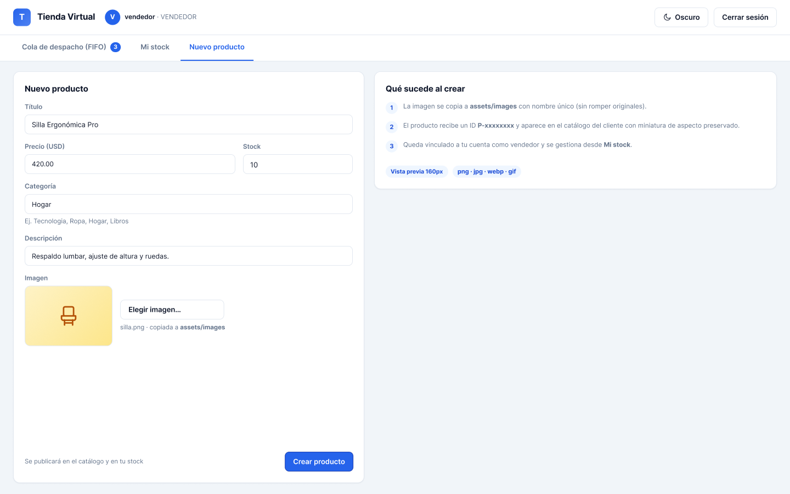

### Usuarios (Admin)
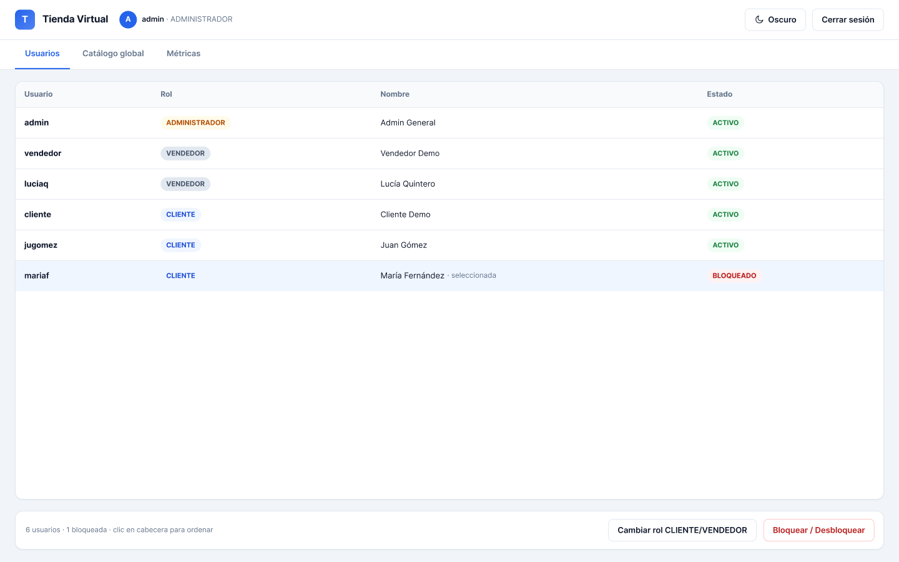

### Catalogo global
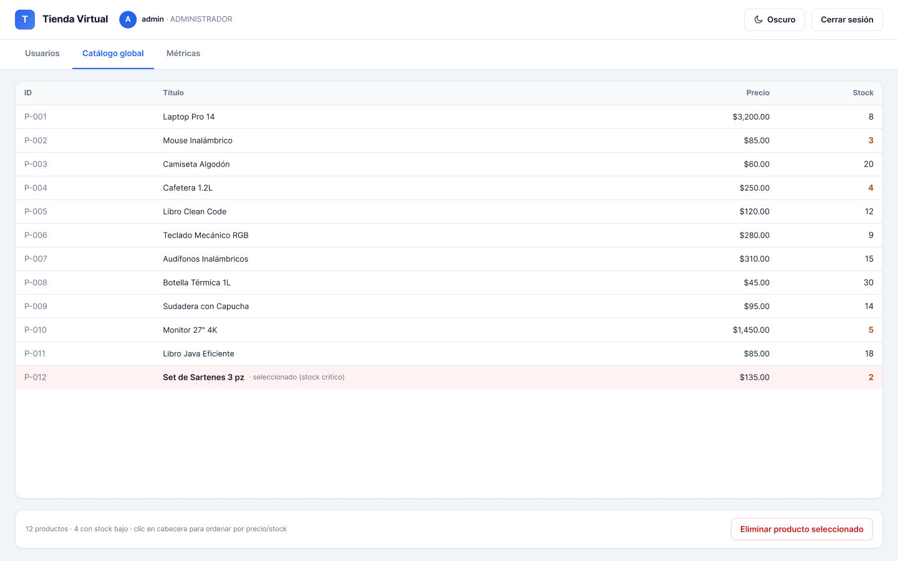

### Métricas
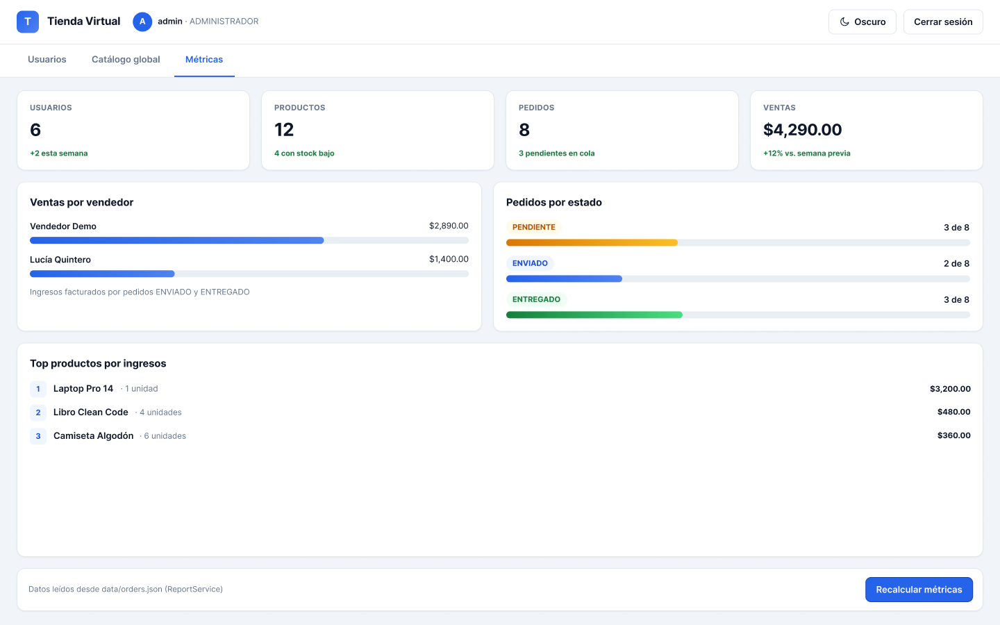
